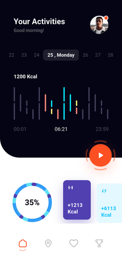
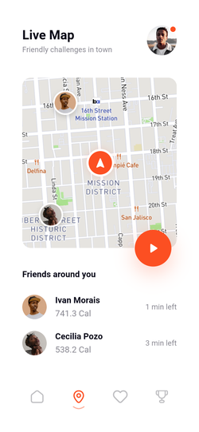
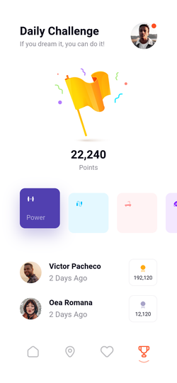
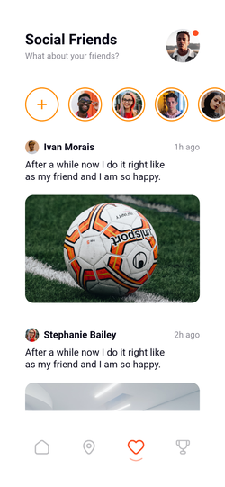

# Daility · Flutter 运动社交 App

基于 Pixso 中的 Daility UI Kit 开发，包含活动统计、好友地图、每日挑战、社交动态、个人资料与消息功能。已读取原文件全部 **5 个页面分类**，实现 UI Kit 的 **10 个界面**，补充通用设置和聊天详情，共 **12 个可查看界面**。

应用保留原稿的英文文案、橙色操作按钮、深色活动面板、图表和图片素材。全部素材随工程打包，可离线运行。当前版本以本地演示数据完成交互，适合 UI 验收、演示与后续功能开发。

## 主要界面

| 活动首页：查看当日能量与运动分类 | 实时地图：发现附近好友与挑战路线 |
| --- | --- |
|  |  |

| 每日挑战：查看积分与排行榜 | 社交动态：浏览好友故事与运动照片 |
| --- | --- |
|  |  |


## 运行

开发与验证使用 Flutter **3.41.6**、Dart **3.11.4**。工程包含 Android、iOS 和 Web 平台目录。

```bash
flutter pub get
flutter devices
flutter run -d emulator-5554
```

也可使用 `flutter run -d chrome`。设备 ID 以 `flutter devices` 返回结果为准。

```bash
flutter build apk --release
flutter build web
```

Android 安装包：`build/app/outputs/flutter-apk/app-release.apk`。当前使用本地调试签名，供安装体验；正式发布需配置发布签名。

## 页面与操作入口

| 界面 | 入口及操作 | 运行截图 |
| --- | --- | --- |
| 活动首页 | 默认首页；选择日期；开始/暂停运动；横向查看运动卡片 | [首页](docs/screenshots/01_home.png) |
| 活动统计 | 首页向上滑动或点击 35% 进度环；向下滑动返回 | [统计](docs/screenshots/02_activity_overview.png) |
| 实时地图 | 底部第二个标签；点击地图或橙色按钮进入路线 | [地图](docs/screenshots/03_live_map.png) |
| 2D 路线 | 实时地图进入；右上角切换维度；顶部开关显示/隐藏路线 | [2D](docs/screenshots/04_map_2d.png) |
| 3D 路线 | 路线页点击维度按钮；底部导航可进入其他主页面 | [3D](docs/screenshots/05_map_3d.png) |
| 社交好友 | 底部第三个标签；查看故事、点开照片、双击照片点赞 | [社交](docs/screenshots/06_social.png) |
| 每日挑战 | 底部第四个标签；切换运动分类，查看积分与排行榜 | [挑战](docs/screenshots/07_challenge.png) |
| 个人资料 | 任一主页面右上角头像；进入消息、邀请、设置和关于 | [资料](docs/screenshots/08_profile.png) |
| 消息列表 | 个人资料 → Messages；搜索好友；新建会话 | [消息](docs/screenshots/09_messages.png) |
| 资料设置 | 个人资料 → Settings → Profile；编辑头像、姓名、生日、性别并提交 | [设置](docs/screenshots/10_settings.png) |
| 通用设置 | Settings → General；切换通知和位置分享偏好 | [通用设置](docs/screenshots/11_general_settings.png) |
| 聊天详情 | 点消息列表或实时地图中的好友；输入并发送本地消息 | [聊天](docs/screenshots/12_chat.png) |

## 项目结构

```text
Daility/
├── lib/
│   ├── main.dart                         # 初始化、全屏模式、读取本地状态
│   ├── app.dart                          # MaterialApp、四标签导航与页面容器
│   ├── core/
│   │   ├── theme.dart                    # 颜色、字体、表单主题
│   │   └── app_state.dart                # ChangeNotifier 状态和本地持久化
│   ├── data/demo_data.dart               # 好友、会话摘要、运动模型/样本
│   ├── features/
│   │   ├── activity/activity_screen.dart # 首页、统计页、日期、运动状态
│   │   ├── map/map_screen.dart           # 地图预览、2D/3D、路线和好友入口
│   │   ├── social/
│   │   │   ├── social_screen.dart        # 故事、动态、照片和点赞
│   │   │   └── messages_screen.dart      # 消息搜索、新建会话、聊天
│   │   ├── challenge/challenge_screen.dart
│   │   └── profile/
│   │       ├── profile_screen.dart       # 资料、邀请、会员预览、关于
│   │       └── settings_screen.dart      # 资料表单与通用设置
│   └── shared/widgets.dart               # 画布适配、头像、标题、按钮、卡片、进度环
├── assets/
│   ├── images/                           # Pixso 本地 PNG / SVG 素材
│   └── fonts/                            # Roboto 字体及许可证
├── test/app_test.dart                    # 本地状态与页面交互测试
├── integration_test/app_flow_test.dart   # Android 全流程测试和截图采集
├── test_driver/integration_test.dart     # 将截图写入 docs/screenshots/
├── scripts/build_gallery.py              # 缩略图与总览生成脚本
├── docs/
│   ├── screenshots/                      # 12 张运行截图、缩略图和总览
│   ├── design-reference/                 # 10 张原稿截图、页面映射和应用 Logo
│   └── 验证记录.md                       # 环境、覆盖流程与复现命令
├── android/                              # Android 工程
├── ios/                                  # iOS 工程
└── web/                                  # Web 入口与应用图标
```

## 架构与数据流

采用按功能分目录的轻量架构，业务源码共 13 个 Dart 文件。`flutter_svg` 负责 SVG 素材，`shared_preferences` 负责本地保存，`cupertino_icons` 补齐 Flutter 自适应控件使用的图标字体；没有引入路由或状态管理框架。

```text
页面操作 → AppState 方法 → SharedPreferences（需要保存的数据）
                         ↓ notifyListeners()
                    ListenableBuilder → 更新界面
```

- **启动与导航**：`main.dart` 加载本地状态；`AppShell` 用 `IndexedStack` 保留主标签的滚动和选中状态；详情页面通过 Flutter `Navigator` 入栈。
- **状态管理**：`AppState` 保存资料、偏好和消息；日期选择、地图维度、路线可见性、搜索关键字和表单草稿由页面局部管理。
- **持久化**：姓名、头像、生日、性别、通知/位置分享偏好和发送的消息存入本机，重启后恢复。运动开关、点赞和运动分类为本次运行的交互状态。
- **视觉复用**：统一头像、标题、按钮和运动卡片；进度环、路线与导航选中标记用 `CustomPainter`；复杂静态图表与照片使用本地资源。
- **屏幕适配**：以原稿 375 × 812 为基准等比适配，宽屏内容最大宽度 480；短屏使用纵向滚动，保留表单和按钮的可访问性。原稿顶部、底部留白为系统区域预留空间。

## 实现范围

已实现主导航、日期和运动状态切换、统计页切换、运动分类选择、地图维度与路线显示、好友会话入口、照片预览和点赞、消息搜索与发送、资料校验和保存、头像选择、偏好设置保存和邀请文案复制。

运动数值、积分、排行榜、好友动态和地图位置是样本数据。当前未接入账号服务、GPS/健康数据、在线地图、真实消息收发、照片上传、通知调度或支付。会员入口提供预览说明；新增故事入口提供功能说明。

原稿使用 Product Sans，工程使用可分发的 Roboto 替代，字形与文字宽度存在差异。设计分类、素材来源和授权介绍见 [Pixso 页面映射](docs/design-reference/页面映射.md)。

## 验证与截图

```bash
flutter analyze
flutter test
flutter drive \
  --driver=test_driver/integration_test.dart \
  --target=integration_test/app_flow_test.dart \
  -d emulator-5554
```

集成测试会清空此应用的本地演示数据，自动走过全部页面并生成截图。详见 [验证记录](docs/验证记录.md) 和 [截图目录](docs/screenshots/README.md)。

已清理 Pixso 导出的空生命周期、重复组件包装、无效包路径、临时服务链接和未使用资源，保留共用 Flutter 控件及设计来源，便于继续接入真实业务。
