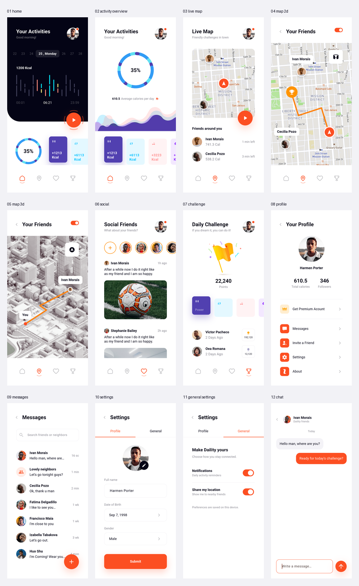

# 界面截图

由 Android API 35 模拟器运行真实 Flutter 页面生成，分辨率为 1125 × 2436。`previews/` 提供文档用缩略图。

| 页面 | 原尺寸截图 |
| --- | --- |
| 活动首页 | [01_home.png](01_home.png) |
| 活动统计 | [02_activity_overview.png](02_activity_overview.png) |
| 实时地图 | [03_live_map.png](03_live_map.png) |
| 2D 路线 | [04_map_2d.png](04_map_2d.png) |
| 3D 路线 | [05_map_3d.png](05_map_3d.png) |
| 社交好友 | [06_social.png](06_social.png) |
| 每日挑战 | [07_challenge.png](07_challenge.png) |
| 个人资料 | [08_profile.png](08_profile.png) |
| 消息列表 | [09_messages.png](09_messages.png) |
| 资料设置 | [10_settings.png](10_settings.png) |
| 通用设置 | [11_general_settings.png](11_general_settings.png) |
| 聊天详情 | [12_chat.png](12_chat.png) |

重新采集：在工程根目录执行 `flutter drive --driver=test_driver/integration_test.dart --target=integration_test/app_flow_test.dart -d <device-id>`。生成缩略图和总览：安装 Pillow 后执行 `python3 scripts/build_gallery.py`。
